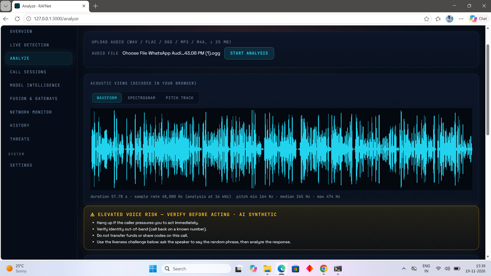

# RAFNet

Deepfake voice and scam-call detection with a live SOC-style dashboard.

RAFNet analyzes audio for synthetic speech and scores calls for scam risk,
using a hybrid classical + quantum model pipeline. Results stream in real
time to a React dashboard backed by FastAPI, WebSockets and Supabase auth.



**Status:** security-audited and hardened (owner-scoped data access,
fail-closed production auth, bounded inputs). 442 tests passing, 3 skipped
(optional XGBoost/PennyLane paths), 0 failing. Known remaining risks and
unverified items are listed in [FINAL_STATUS.md](FINAL_STATUS.md).

## Features

- Deepfake / synthetic voice detection from uploaded audio
- Scam-call risk scoring
- Live analysis over WebSockets with a SOC-style dashboard
- Supabase authentication with per-user data isolation
- Rate limiting, request size limits and browser security headers

## Tech stack

- **Backend:** Python, FastAPI, WebSockets
- **Models:** classical + quantum branches, calibration and decision gate
- **Frontend:** React, TypeScript, Vite
- **Data / auth:** Supabase (Postgres, Auth, row-level security)

## Project layout

```
src/rafnet/        Core package: models, inference, SOC API
backend/           Legacy backend scaffold (disabled by default)
frontend/          React dashboard
supabase/          SQL migrations (001-005) and verify script
tests/             Test suite
tools/, scripts/   Evaluation and data tooling
reports/           Experiment and evaluation reports
```

## Quick start

See [LOCAL_RUN.md](LOCAL_RUN.md) for running locally (`start-local.ps1`
on Windows) and [DEPLOYMENT.md](DEPLOYMENT.md) for production setup.

Run the tests:

```
pytest
```

## Security

An internal audit found and fixed about 17 issues, including cross-user
data access, live-session hijacking, WebSocket auth downgrade and a
fail-open production configuration.

Production requires these settings:

```
RAFNET_ENV=production
SOC_REQUIRE_AUTH=true
SUPABASE_URL=...
SUPABASE_ANON_KEY=...
SUPABASE_SERVICE_ROLE_KEY=...   # server-side only, never in the frontend
SOC_CORS_ORIGINS=...            # explicit origins, no wildcard
MOCK_INFERENCE=false
```

Run migrations `001` through `005` in order.

**Not yet verified:** migrations 004/005 against a live Supabase project,
real RLS behavior, production HTTPS/HSTS, and multi-replica deployments.
See [FINAL_STATUS.md](FINAL_STATUS.md) for the full list.

## Documentation

[API.md](API.md) · [ARCHITECTURE.md](ARCHITECTURE.md) ·
[DATABASE.md](DATABASE.md) · [DEPLOYMENT.md](DEPLOYMENT.md) ·
[LOCAL_RUN.md](LOCAL_RUN.md)